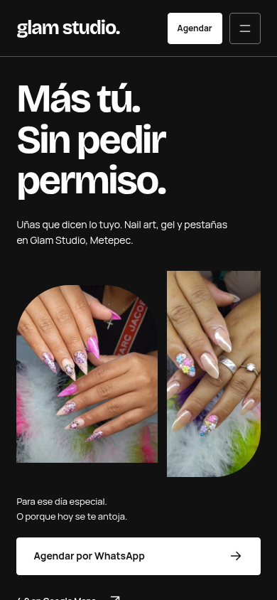
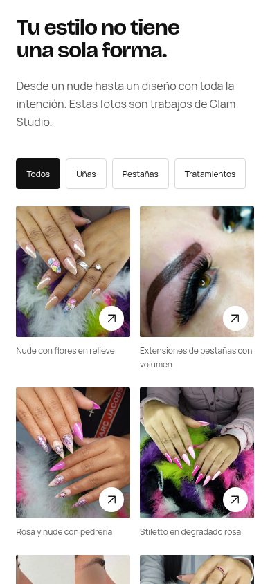
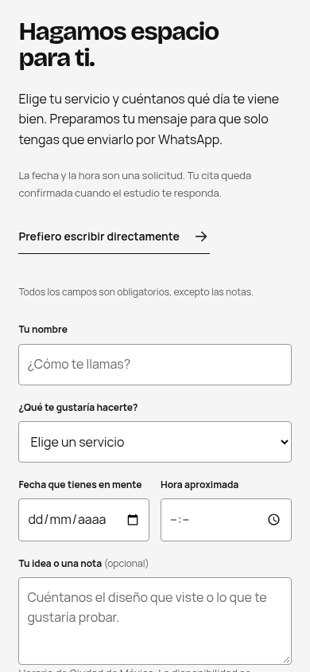
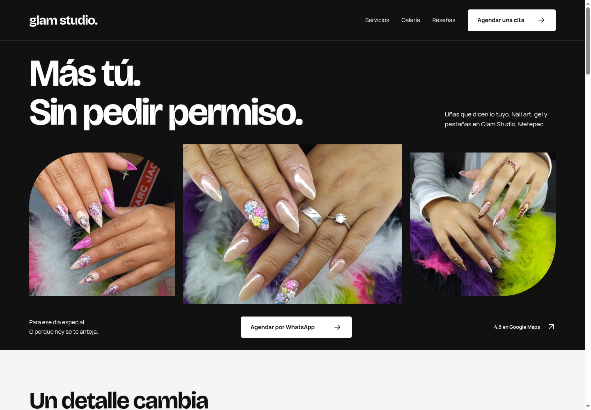
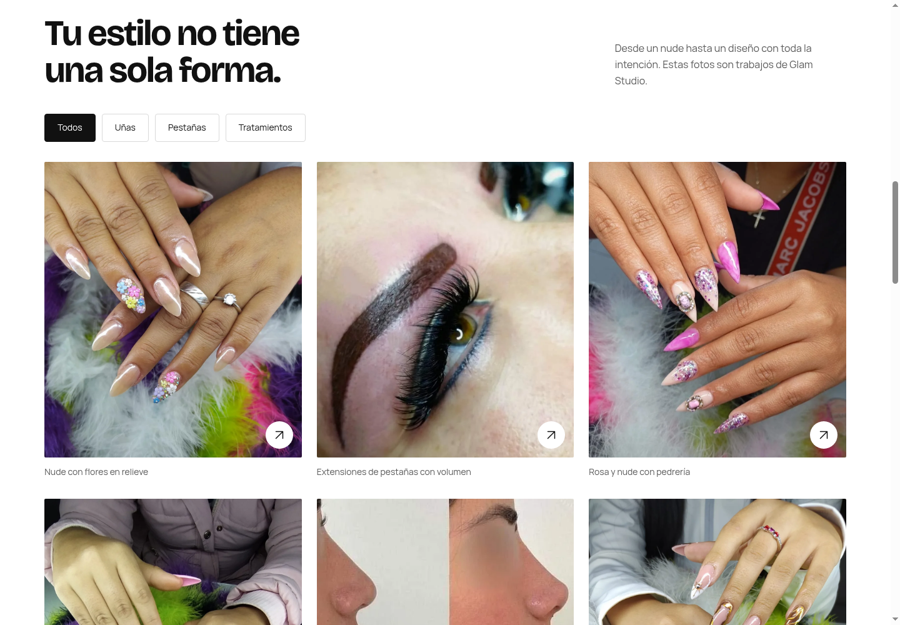

# Glam Studio

Sitio web para Glam Studio, estudio de nail art, uñas en gel y extensiones de pestañas en San Gaspar Tlahuelilpan, Metepec.

El proyecto presenta los servicios, los trabajos del estudio y las opiniones de sus clientas en una experiencia responsive, con solicitudes de cita por WhatsApp. Forma parte de mi portafolio de diseño y desarrollo web. La identidad visual combina una interfaz en blanco y negro con fotografías originales a color.

## Vista previa móvil

<table>
  <tr>
    <th>Inicio</th>
    <th>Galería de trabajos</th>
    <th>Solicitud de cita</th>
  </tr>
  <tr>
    <td><a href="docs/screenshots/mobile-inicio.png"></a></td>
    <td><a href="docs/screenshots/mobile-galeria.png"></a></td>
    <td><a href="docs/screenshots/mobile-cita.png"></a></td>
  </tr>
</table>

Capturas reales del sitio a 390 px de ancho. Haz clic en cada imagen para verla en detalle.

## Vista previa desktop

### Inicio

[](docs/screenshots/desktop-inicio.png)

<details>
  <summary>Ver galería de trabajos en desktop</summary>

[](docs/screenshots/desktop-galeria.png)

</details>

Capturas reales del sitio a 1440 px de ancho. Haz clic en cada imagen para verla en detalle.

## Funcionalidades

- Portada fotográfica y catálogo de nail art, manicura en gel, extensiones de pestañas y tratamientos.
- Galería de 14 trabajos reales con filtros por servicio, ampliación y navegación entre fotografías.
- Tres extractos atribuidos de reseñas públicas de Google Maps, con enlace a la ficha y fecha de consulta.
- Solicitud de cita con selección de servicio, fecha y hora aproximada; validación del horario de Ciudad de México y vista previa del mensaje.
- Contacto por WhatsApp con mensajes prellenados, también desde cada trabajo de la galería. La reserva se confirma por chat; el sitio no envía mensajes automáticamente.
- Dirección, horarios, indicaciones para llegar y redes sociales del estudio.
- Metadatos sociales y datos estructurados del negocio para buscadores.
- Diseño adaptable, navegación por teclado, gestión del foco y soporte de movimiento reducido.
- Fuentes alojadas localmente y fotografías optimizadas; acceso directo a WhatsApp cuando JavaScript no está disponible.

## Tecnologías

- **HTML5 y CSS** para el contenido semántico, la composición y los estilos responsive.
- **JavaScript nativo y módulos ES** para la navegación, la galería y las reglas de solicitud de citas, sin frameworks ni dependencias de ejecución.
- **Bricolage Grotesque y Manrope** alojadas localmente, con licencias OFL incluidas en `studio-glamour-landing/assets/fonts/`.
- **WebP** para las copias optimizadas de las fotografías; los originales se conservan en el repositorio.
- **Vercel** como configuración de publicación estática, sin paso de compilación.

## Desarrollo local

Requiere **Python 3** para el servidor local. **Node.js 22 o posterior** es opcional para comprobar la sintaxis de JavaScript. Ejecuta los comandos desde la raíz del repositorio.

```sh
python -m http.server 4173 --bind 127.0.0.1 --directory studio-glamour-landing
```

Abre http://127.0.0.1:4173/. No necesita `npm install`, variables de entorno ni compilación. Las fuentes y las fotografías necesarias ya están incluidas. Detén el servidor con `Ctrl+C`.

## Verificación y compilación

```sh
node --check studio-glamour-landing/script.js
node --check studio-glamour-landing/booking.mjs
```

Estos comandos comprueban la sintaxis de los módulos JavaScript. Con el servidor local activo, comprueba en el navegador la navegación, los filtros de la galería, la ampliación de fotografías y la vista previa de la solicitud de cita. No necesitas enviar el mensaje de WhatsApp para revisar el formulario.

El proyecto no tiene paso de compilación ni genera `dist/`: el directorio `studio-glamour-landing/` contiene el sitio listo para servir.

## Configuración

- `studio-glamour-landing/index.html`: contenido, datos del negocio, enlaces de contacto, catálogo visible, reseñas y metadatos.
- `studio-glamour-landing/booking.mjs`: catálogo validado, reglas de fechas y horarios, zona `America/Mexico_City` y número de WhatsApp en formato internacional, solo dígitos. Mantén estos valores sincronizados con el HTML al cambiar servicios, horarios o teléfono.
- `studio-glamour-landing/style.css`: fuentes, colores, composición y ajustes responsive.
- `vercel.json`: publica `studio-glamour-landing/`, sin framework ni comando de compilación.

No se requieren variables de entorno ni un backend. El formulario prepara una consulta; no comprueba disponibilidad real ni confirma citas. Las reseñas son extractos de la ficha pública de Google Maps, enlazada desde el sitio, y no se actualizan automáticamente.

Los horarios publicados se conservan según lo confirmado para el sitio y difieren de los mostrados en Google Maps. Antes de modificarlos, confírmalos con el negocio y actualiza también los datos estructurados y las reglas del formulario.

## Estructura

```text
studio-glamour-landing/
  index.html       Contenido, reseñas, contacto y firma
  style.css        Sistema visual adaptable
  script.js        Navegación, galería y formulario
  booking.mjs      Reglas puras de reserva y URL de WhatsApp
  favicon.svg      Icono del sitio
  assets/          Fuentes y copias optimizadas de las fotografías
  images/          Fotografías originales
docs/
  screenshots/     Capturas móviles y de escritorio del sitio
vercel.json        Configuración de publicación estática
```
